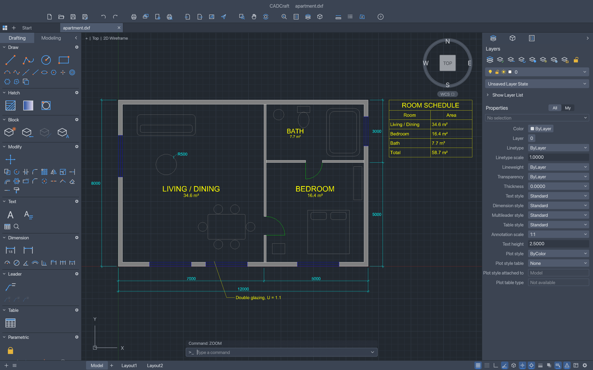
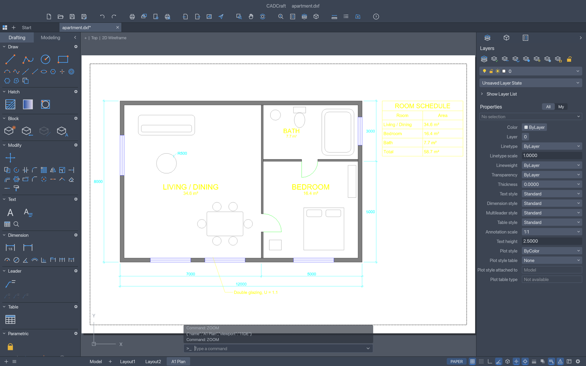
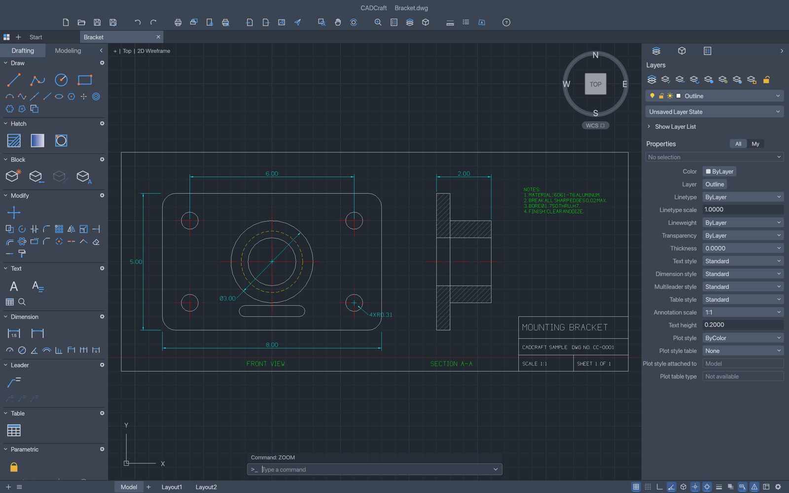

<p align="center">
  <a href="../../releases">
    <picture>
      <source media="(prefers-color-scheme: dark)" srcset="docs/brand/artcraft-logo-white.svg">
      
    </picture>
  </a>
</p>

<h1 align="center">CADCraft</h1>

<p align="center">
  <b>Computer-aided design and drafting; an open-source, clean-room reimplementation of Autodesk AutoCAD, rebuilt in pure Rust.</b>
</p>

<p align="center">
  A fast, open-source take on the AutoCAD workflow: the command line, object snaps, layers,
  dimensions, hatches, blocks and DXF drawings you already know. It runs natively on macOS,
  Windows, Linux and FreeBSD, and in the browser via WebAssembly.<br>
  <i>By the ArtCraft team.</i>
</p>

<p align="center">
  
  
  
  
  
</p>

<br>

<p align="center">
  
</p>

## Screenshots

<table>
  <tr>
    <td width="50%"></td>
    <td width="50%"></td>
  </tr>
  <tr>
    <td><sub><b>Layouts</b>: paper space with viewports, page setups and PLOT to PDF. Double-click a viewport to work in model space through it.</sub></td>
    <td><sub><b>Mounting bracket</b>: a two-view part drawing with centre lines, hidden lines, an ANSI31 section hatch and a title block.</sub></td>
  </tr>
</table>

## Why CADCraft

- **The workflow you know.** Type `L`, click two points, type `@5<45`, press Enter. The command
  line, prompts with clickable `[Keywords]`, AutoComplete, object snaps, polar tracking, ortho,
  direct distance entry, window and crossing selection, grips, and right-click-to-repeat behave
  the way decades of drafting habit expect.
- **Open files.** DXF is read and written natively (ASCII and binary, R12 through 2018), and DWG
  files (R13 through 2018) open and save through the open-source acadrust library. Export to SVG
  and PNG today.
- **Fast and native.** Pure Rust and egui, no Electron, no web view. One binary on macOS
  (universal), Windows, Linux and FreeBSD, plus a WebAssembly build for the browser.
- **Built for agents.** Every menu item, tool and prompt is a command. Agents can type at the
  command line exactly like a person, call any command with JSON, inspect the drawing to verify
  their work, and render it — over MCP, a JSON control channel, or the CLI.
- **Free.** MIT OR Apache-2.0, with no account and no subscription.

## What works today

| Area | Status |
|---|---|
| Drawing area | Model space with adaptive grid, axes, pan/zoom (wheel, middle-drag, pinch), crosshair cursor with pickbox, UCS icon, ViewCube, viewport label |
| Command line | Prompts with keywords, history, AutoComplete, aliases, `@dx,dy`, `@d<a`, `#x,y`, direct distance entry, Enter/space/right-click to repeat, transparent commands, `.scr`-style scripts |
| Draw | LINE, PLINE (arcs, widths), CIRCLE (center/radius/diameter, 2P, 3P), ARC, RECTANG (fillet/chamfer), POLYGON, ELLIPSE (+arcs), SPLINE, POINT, XLINE, RAY, DONUT, TEXT, MTEXT |
| Modify | ERASE, MOVE, COPY, ROTATE, SCALE, MIRROR, STRETCH, OFFSET, TRIM, EXTEND, FILLET, CHAMFER, BREAK, JOIN, EXPLODE, rectangular/polar ARRAY, draw order, OVERKILL |
| Precision | Object snaps (endpoint, midpoint, center, geometric center, node, quadrant, intersection, insertion, perpendicular, tangent, nearest; deferred tangent/perpendicular for the first point of a line, e.g. belt lines tangent to two circles), polar tracking, ortho, grid snap |
| Layers & properties | Layers palette and Layer Properties Manager (on/off, freeze, lock, plot, colour, linetype), layer tools (isolate, freeze, off, lock, match, previous), Properties palette with per-object editing, linetypes, lineweights, colour index and true colour |
| Annotation | All DIM* commands with full DIMSTYLE variables, overrides and every arrowhead, associative dimensions that follow geometry, MLEADER, TABLE, TrueType fonts (`.ttf`, `.otf`, `.ttc` collections), MTEXT formatting codes (fonts, heights, colours, stacked fractions), our own single-stroke drafting font |
| Hatch & blocks | Pick-point hatch boundaries with islands, pattern, solid and gradient fills from our own pattern library, BLOCK/INSERT, attributes and nested blocks |
| Files | DXF read (R12–2018, ASCII and binary) and write (R2000), including dimension styles, associativity, tables and constraints; DWG read (via the acadrust library) and write (R2000); PDF plotting, SVG and PNG export. |
| Layouts & plotting | Paper-space layouts, viewports (scale, lock, per-viewport layer freeze), MSPACE/PSPACE through viewports, page setups, PLOT and EXPORTPDF |
| Parametric | Geometric and dimensional constraints, AUTOCONSTRAIN, PARAMETERS with expressions, conflict detection; constraints re-solve after every edit |
| Grips | Hot grips with Space to cycle Stretch, Move, Rotate, Scale and Mirror |
| Interface languages | English and Ukrainian (Українська), live switching and a remembered Auto/system-language choice; |
| Automation | MCP server, JSON control channel, `cadcraft-cli` (info, convert, run, commands, mcp) |

## Quick start

[View all releases](../../releases)

| Platform | Download | Run |
|----------|----------|-----|
| **Windows x64** | [cadcraft-x64.7z](../../releases) | Run installer → launch `cadcraft-x64.7z` |
| **Linux x64** | [cadcraft-Linux-x64.run](../../releases) | `chmod +x` → run installer |
| **macOS Apple Silicon** | [cadcraft-macOS-arm64.dmg](../../releases) | Open DMG → drag to Applications |

### Fonts

CADCraft never ships fonts; it uses the TrueType/OpenType fonts installed on your system. SHX
fonts (including big fonts such as `chineset.shx`) aren't read yet: text in an SHX style is drawn
with our own stroke font, and any character a text's font lacks (CJK, for example) is drawn from
an installed font that has it, preferring wide-coverage fonts such as Noto Sans CJK, Source Han
Sans, WenQuanYi, PingFang or Microsoft JhengHei. Two settings, set with `SETVAR` or (for every
run) an environment variable, steer this:

| Variable | Environment | Meaning |
|---|---|---|
| `FONTALT` | `CADCRAFT_FONTALT` | Font used instead of a text style font that can't be found (an SHX file, a missing TTF), by file or family name, e.g. `Noto Sans CJK TC`. Empty (default) = our stroke font. |
| `FONTFALLBACK` | `CADCRAFT_FONTFALLBACK` | Fonts tried first for characters a text's font lacks, comma-separated, e.g. `Noto Sans CJK TC, msjh.ttc`. |

`.` clears either one.

### Logs

The desktop app writes its `log` records to standard error and to `logs/cadcraft.log` in the
settings directory (Linux and the BSDs `~/.config/cadcraft/logs/`, or
`$XDG_CONFIG_HOME/cadcraft/logs/`; macOS `~/Library/Application Support/CADCraft/logs/`; Windows
`%APPDATA%\CADCraft\logs\`; or under `CADCRAFT_CONFIG_DIR`). A start from a desktop menu or the
Dock has no terminal, so this file is what to attach to a bug report. Each launch moves the
previous log to `cadcraft.1.log` (and that one to `cadcraft.2.log`), so the log of a run that
crashed survives the next start. The file stops growing at 16 MiB. `--version` writes no file.

| Variable | Effect |
|---|---|
| `CADCRAFT_CONFIG_DIR` | Use this directory instead of the platform settings directory (the log goes to its `logs/`) |
| `RUST_LOG` | Log levels for standard error and the log file. Default: `info` for CADCraft's own crates, `warn` for everything else. env_logger-style directives replace that, e.g. `RUST_LOG=debug`, `RUST_LOG=warn,cadcraft_io=trace` or `RUST_LOG=info,wgpu_core=warn`; a directive ending in `*` covers every target starting with it (`cadcraft*=debug`). `cadcraft_engine=debug` also logs every command-line message. |

The logger is `apps/cadcraft/src/logging.rs`; the web build logs to the browser console instead.

## Architecture

```text
geom ─┐                       f64 geometry: arcs, bulges, splines, intersections, offsets
dxf   │  (standalone)         DXF tag reader/writer
color ┤                       colour index, true colour
doc   ┤                       drawing database, copy-on-write entity store (cheap undo)
fonts ┤ render               stroke font + TEXT/MTEXT layout │ display lists, linetypes, hatches, dims, CPU raster
io    ┤                       DXF mapping, SVG/PNG export
engine┤                       sessions, commands, command line + prompts, snaps, selection, undo
ui-egui · mcp                 the swappable egui front end · MCP server
apps: cadcraft · cadcraft-cli · cadcraft-web
```

Nothing below `ui-egui` knows about egui, so the front end can be replaced. `cargo xtask ci`
checks formatting, clippy, tests, asset attribution, the crate layering and the wasm build.

Drafting and layer-palette icon buttons use the pinned `craft-ui` button component for interaction,
accessible labels and keyboard focus. CADCraft keeps its multicolor icon painter, dark palette,
disabled tint and tool commands. The native host saves workspace visibility and toolset choices
atomically; `CADCRAFT_CONFIG_DIR` selects an isolated profile. Compact toolbar groups move into a
More menu, and status readouts truncate with a full-value tooltip before they reach layout tabs.
Painted toolbar and tab controls
have accessible labels and visible keyboard focus. Property controls remain application-specific.

## Accessibility

Over the drawing area CADCraft hides the system cursor and draws its own crosshair. Tools that follow the system cursor (Windows Magnifier set to follow or centre the mouse pointer, other screen magnifiers, screen recorders, remote desktops) lose track of it there. Turn on **View ▸ Accessibility ▸ Show System Cursor** to keep a small system crosshair visible at the centre of the drawn one, or start CADCraft with the environment variable `CADCRAFT_SYSTEM_CURSOR=1` (on Windows, set it once with `setx CADCRAFT_SYSTEM_CURSOR 1` and start CADCraft again). Agents can switch it with the control channel: `ui.set {"systemCursor": true}`.

## Roadmap

See [ROADMAP.md](ROADMAP.md) for the stage, measured parity and the estimate of remaining work, and [docs/gaps.md](docs/gaps.md) for everything still missing.

## License and credits

CADCraft is dual-licensed under [MIT](LICENSE-MIT) or [Apache-2.0](LICENSE-APACHE), at your option.
Copyright (c) 2026 ArtCraft Team and the CADCraft contributors. Required notices are in [NOTICE](NOTICE).

<sub>Autodesk, AutoCAD and DWG are trademarks or registered trademarks of Autodesk, Inc. in the United States and/or other countries. CADCraft is an independent, open-source project and is not affiliated with, sponsored by or endorsed by Autodesk, Inc.; these names are used only to describe the workflows and file formats it is compatible with.</sub>

Tool Sets, Layers, and Properties can be regrouped, split, floated within the app window, closed, and reopened. The drawing canvas stays visible and cannot be closed or turned into a tab. Drag a panel header to a target edge or another header. Its context menu offers Float panel, Move to group, and Close panel. Existing panel toggles reopen panels at their saved location; Reset Panel Layout restores the app layout. Floating panels remain inside the current app window.
